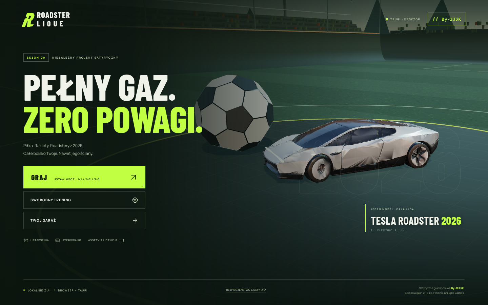

# Roadster Ligue — By-G33K

**Satirical rocket-powered roadster football. Browser + Tauri 2 desktop.**

[Play in the browser](https://programmerwunrealu.github.io/roadster-ligue/) · [Source](https://github.com/ProgrammerWUnrealu/roadster-ligue) · [Desktop build guide](TAURI.md) · [Safety & satire](SAFETY.md) · [Asset licenses](public/ASSET_SOURCES.md)



> **Photosensitivity warning:** flashing lights, high-contrast patterns and rapid camera movement can trigger seizures. A static warning requires acknowledgement before 3D graphics or audio start on every launch. Reduced effects are recommended, but do not eliminate risk. **This game is satire**, not a Tesla product or a realistic vehicle simulation. No affiliation with Tesla, Psyonix or Epic Games. See [SAFETY.md](SAFETY.md).

New in **v1.1**: By-G33K opening menu, initial photosensitivity and satire notices, reduced-effects controls, relative-URL browser hosting, a real Tauri 2 Rust app, native icons, least-privilege external credit links and CI workflows for Pages and desktop installers.

Grywalna, trójwymiarowa piłka samochodowa w przeglądarce. Wszystkie auta korzystają ze społecznościowego modelu **Tesli Roadster 2026**. Własny interfejs, arena Neon Park i rakietowe efekty.

## Najprościej: bez instalacji

Otwórz plik **Roadster Ligue.html** w aktualnym Chrome, Edge, Firefox lub Safari z obsługą WebGL 2. Przeczytaj ostrzeżenie i wybierz **ROZUMIEM · PRZEJDŹ DO MENU**. W nowym menu **By-G33K** wybierz **GRAJ** → **WJEDŹ NA BOISKO** albo **SWOBODNY TRENING**.

Wersja jednoplikowa zawiera kod, modele, czcionki, oświetlenie HDR i dekoder. Nie potrzebuje połączenia z internetem ani serwera. Wbudowany podgląd może blokować pełny ekran lub pad — w takim przypadku otwórz pobrany plik bezpośrednio w przeglądarce.

## Co działa

- Statyczny ekran bezpieczeństwa przed startem 3D, jawna informacja o satyrze i menu startowe **By-G33K**.
- Zalecane ograniczone efekty: wyłączone cząsteczki, drgania, animacje UI, ruch bezczynności menu i zoom dopalacza. Nie jest to tryb „bezpieczny od napadów”.

- Mecze **1v1, 2v2 i 3v3**: Ty, ewentualni partnerzy AI i drużyna przeciwników AI.
- Trzy poziomy AI; mecze trzyminutowe, odliczanie i wznowienia po golach.
- Jazda, hamulec i cofanie, powerslide, dopalacz i prędkość naddźwiękowa.
- Skok o zmiennej wysokości, drugi skok, kierunkowe flipy, pochylenie / obrót w powietrzu.
- Rampy, przyczepność do ścian, kolizje aut i przestrzenna fizyka piłki.
- Małe pady: +12 dopalacza / odrodzenie po 4 s. Duże: 100 / odrodzenie po 10 s.
- Demolki przy dużej prędkości i powrót auta po 3 s aktywnej gry.
- Gole, eksplozje, rzeczywiste powtórki z bufora ostatnich sekund i ich pomijanie spacją.
- Przy 0:00 gramy do opadnięcia piłki; remis uruchamia dogrywkę do złotego gola.
- Tabela punktów, goli, asyst, strzałów i obron; demolki również są liczone.
- Swobodny trening bez przeciwników, limitu czasu i limitu dopalacza.
- Garaż: pięć lakierów i trzy wykończenia, obracanie podglądu, zapis preferencji.
- Kamera na piłkę / kamera samochodu, minimapa, komunikaty i szybki czat.
- Syntezowane efekty dźwiękowe, regulacja głośności, pauza i ustawienia jakości.
- Klawiatura i mysz, standardowy pad oraz dotykowy joystick i przyciski.
- Responsywny interfejs, poziomy szczegółowości modeli oraz lżejszy tryb dla renderowania programowego.

**Zakres:** jest to lokalny prototyp, nie pełna kopia Rocket League. Nie ma sieciowego multiplayera, matchmakingu, rankingu ani kont. Fizyka i parametry są autorskim przybliżeniem arcade, nie identyczną implementacją oryginalnej gry ani symulacją osiągów prawdziwej Tesli.

## Sterowanie

| Działanie | Klawiatura / mysz |
|---|---|
| Gaz / hamulec i cofanie | W / S lub strzałki |
| Kierownica | A / D lub strzałki |
| Dopalacz | Lewy przycisk myszy, F lub lewy Ctrl |
| Skok | Spacja; przytrzymanie przedłuża pierwszy skok |
| Drugi skok | Ponownie Spacja w oknie drugiego skoku |
| Flip | Drugi skok + kierunek |
| Drift | Shift; alternatywnie prawy przycisk myszy |
| Pochylenie w powietrzu | W / S |
| Skręt w powietrzu | A / D |
| Obrót osiowy | Q / E |
| Kamera na piłkę | C |
| Postaw samochód | R |
| Piłka na środek w treningu | B lub Backspace |
| Tabela | Przytrzymaj Tab |
| Szybki czat | 1–4 |
| Pauza | Escape lub P |
| Pomiń powtórkę | Spacja |

**Pad (mapowanie standardowe):** RT gaz, LT hamulec, lewy drążek kierownica / pochylenie, A skok, B dopalacz, X drift, Y kamera, LB/RB obrót osiowy, Start pauza. Dostępność Gamepad API zależy od przeglądarki i jej uprawnień.

## Kod źródłowy

Wymagania: Node.js **20.19+** lub nowsza obsługiwana wersja LTS.

```bash
npm ci
npm run dev
```

Otwórz adres podany przez Vite (zwykle `http://localhost:5173`). Serwer jest skonfigurowany również do zdalnego podglądu.

```bash
npm run build       # wersja do hostingu statycznego w dist/
npm run preview     # podgląd gotowego buildu
npm run standalone  # samowystarczalny Roadster-Ligue.html
```

Do wdrożenia wystarczy dowolny hosting statyczny obsługujący WebAssembly. Względne URL-e działają także w podkatalogu, np. `/roadster-ligue/`; nie jest potrzebny rewrite dla routera. Wszystkie zasoby są lokalne. Nie ma kluczy API ani zewnętrznych usług.

## Browser publishing / GitHub Pages

The `Browser checks & Pages` workflow builds the static `dist/`, runs gameplay, subpath-hosting and offline tests, then deploys the browser game on pushes to `main`. For a fork, enable **Settings → Pages → Source: GitHub Actions**. There is no backend, account system, multiplayer server or API key.

## Tauri desktop

Real Tauri 2 sources, Cargo lockfile, platform bundle configuration, app icons, bundled licenses and a restricted capability file are included. After installing stable Rust and the OS prerequisites described in [TAURI.md](TAURI.md):

```bash
npm ci
npm run desktop:dev
npm run tauri -- build -- --locked
```

For a regular local build, `npm run desktop:build` also works. The explicit locked command above forwards the lock flag to Cargo. Native output is in `src-tauri/target/release/bundle/`. The manual **Tauri desktop installers** GitHub Actions workflow can build Linux, Windows and macOS on native runners. Builds are unsigned development artifacts, not notarized production releases. See [TAURI.md](TAURI.md) for installer targets, signing caveats and exact prerequisites.

### Struktura

- `src/main.js` — menu, HUD, klawiatura / mysz / pad / dotyk, ustawienia.
- `src/game.js` — mecz, arena fizyczna, wynik, statystyki, gole i powtórki.
- `src/vehicle.js` — zawieszenie raycast, sterowanie, przyczepność, skoki, flipy i AI.
- `src/visuals.js` — renderer, oświetlenie, boisko, stadion, modele i LOD.
- `src/effects.js` — cząsteczki i dźwięk Web Audio.
- `src/style.css`, `src/responsive-extra.css`, `src/opening.css` — interfejs, statyczne ostrzeżenie i nowe menu.
- `src/assets.js` — URL-e zasobów dla przeglądarki, podkatalogów i Tauri.
- `src-tauri/`, `TAURI.md` — natywna aplikacja Tauri 2 i instrukcja kompilacji.
- `.github/workflows/` — testy, GitHub Pages i kompilacja instalatorów.
- `SAFETY.md` — ostrzeżenie o fotowrażliwości i deklaracja satyry (PL/EN).
- `public/assets/` — gotowe zoptymalizowane modele, HDRI, czcionki i dekoder Draco.
- `public/ASSET_SOURCES.md`, `public/licenses/` — pochodzenie i licencje.
- `make-standalone.mjs` — pakuje całą grę do jednego pliku, także dla podglądu bez sieci.
- `prepare-assets.mjs` — opcjonalny pipeline optymalizacji modelu; nie jest potrzebny do gry.

### Testy

Po zbudowaniu gry (test sam uruchamia i zamyka serwer podglądu):

```bash
npx playwright install chromium
npm run build
npm test
npm run test:subpath
```

Na systemie Linux mogą być potrzebne biblioteki systemowe Chromium (`npx playwright install-deps chromium`; nazwy pakietów zależą od dystrybucji).

Test sprawdza też ostrzeżenie przed 3D, powrót ostrzeżenia przy kolejnym uruchomieniu, satyrę, By-G33K, menu i ograniczone efekty. Obejmuje 19 sprawdzeń fizyki i reguł (m.in. skok, flip, ściany, gole, powtórkę, dogrywkę, AI, demolki i respawn), garaż, dialogi, sterowanie klawiaturą, pauzę oraz ekran pionowy i poziomy. Testuje również brak błędów JavaScript i shaderów.

```bash
npm run standalone
npm run test:offline
```

Test offline uruchamia samowystarczalny HTML w iframe `sandbox="allow-scripts"` z wyłączoną siecią. Sprawdza potwierdzenie ostrzeżenia, uruchomienie modelu i treningu z nowego menu. `npm run test:subpath` osobno sprawdza hosting w `/roadster-ligue/` bez zasobów pod głównym adresem hosta.

## Modele i uczciwe oznaczenie projektu

Model **„Tesla Roadtser 2026”** autorstwa **asiphy007**, CC BY 4.0, został pobrany z publicznego mirrora i zweryfikowany ze stroną źródłową w Sketchfab. Autor oznacza go jako wygenerowany z pomocą AI. Jest to wizualna interpretacja Roadstera pokazanego w 2026, **nie oficjalny CAD ani dokładny model producenta**. W grze został uproszczony, przeskalowany, przekolorowany i wyposażony w dodatkowe światła / porty dopalacza.

Pełne źródła i wykaz zmian: [public/ASSET_SOURCES.md](public/ASSET_SOURCES.md).

Nie wykorzystano modeli, map, interfejsu ani dźwięków Rocket League. Projekt jest niezależny, satyryczny i nie jest powiązany z Tesla, Psyonix ani Epic Games. Znaki towarowe należą do ich właścicieli. Oryginalny kod projektu: MIT; zewnętrzne zasoby zachowują własne licencje.
